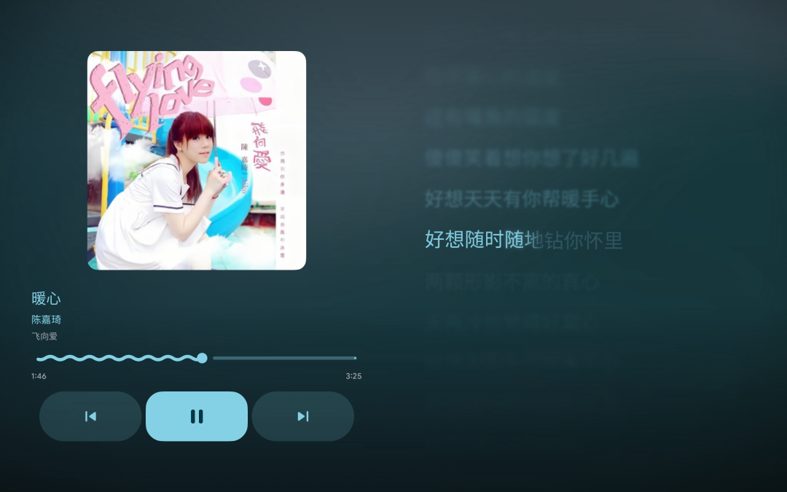
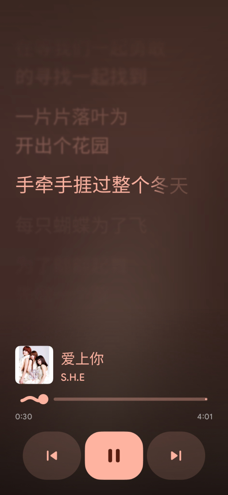

<p align="center">
  
</p>

<h3 align="center">Seize the Line, Keep the Time</h3>

<p align="center">
  Live, word-by-word lyrics for any Android media session
</p>

<p align="center">
  <a href="https://developer.android.com/about/versions/11"><picture><source media="(max-width: 767px)" srcset="https://img.shields.io/badge/Android-11%2B-6750A4?style=flat-square&logo=android&logoColor=white&labelColor=1D1B20" /></picture></a>
  <a href="https://kotlinlang.org/docs/multiplatform.html"><picture><source media="(max-width: 767px)" srcset="https://img.shields.io/badge/Kotlin-Multiplatform-625B71?style=flat-square&logo=kotlin&logoColor=white&labelColor=1D1B20" /></picture></a>
  <a href="https://m3.material.io/"><picture><source media="(max-width: 767px)" srcset="https://img.shields.io/badge/Material_3-Expressive-7D5260?style=flat-square&logo=materialdesign&logoColor=white&labelColor=1D1B20" /></picture></a>
  <br />
  <a href="https://developer.android.com/jetpack/compose"><picture><source media="(max-width: 767px)" srcset="https://img.shields.io/badge/Jetpack-Compose-6750A4?style=flat-square&logo=jetpackcompose&logoColor=white&labelColor=1D1B20" /></picture></a>
  <a href="LICENSE"><picture><source media="(max-width: 767px)" srcset="https://img.shields.io/badge/license-GPL--3.0-625B71?style=flat-square&labelColor=1D1B20" /></picture></a>
</p>

<div align="center">

**`io.github.jayfunc.carpelines`** · Android 11+ (API 30) · target SDK 37 · GPL-3.0-or-later

**English** · [简体中文](README.zh-CN.md)

</div>

---

## Table of Contents

- [Highlighted Features](#-highlighted-features)
- [Screenshots](#-screenshots)
- [Download & Install](#-download--install)
- [Lyrics Engine](#-lyrics-engine)
- [Documentation](#-documentation)
- [Community](#-community)
- [Contribute & Build](#-contribute--build)
- [Tech Stack](#-tech-stack)
- [License & Credits](#-license--credits)

---

##  Highlighted Features

### Lyrics that keep up with the line

- **Word-by-word sweep** — timing comes from the lyric file itself, so each word lights up as it is sung instead of the whole line snapping at once.
- **Per-character emphasis, CJK included** — Chinese, Japanese and Korean lyrics can sweep character by character, with the same spring-driven motion as Latin words.
- **Duets and backing vocals** — two-column voice layout, background-vocal lines and per-line styling keep overlapping parts readable.
- **Translations and romanization** — translated and transliterated lines stack under the original without breaking the timing.

### An expressive canvas

- **Artwork-derived colour** — the edge-to-edge lyrics page samples the current cover art and builds its palette from it.
- **Fluid and album-blur backgrounds** — two ambient backdrops, the fluid one ported from BetterLyrics' `FluidBackgroundEffect` shader, plus animated blur and trailing long-note glows.
- **Scrolling lyric list** — the playing line stays in the middle while the rest of the song moves past it.
- **An auto-hiding transport pill** — previous / play-pause / next and progress float over the lyrics, fade out after a few seconds, return on a tap and stay while paused. The tonal button at the top start is the way out.
- **Per-track offset and lyric cards** — nudge timing for a stubborn file, then export the current lines as a shareable card.

### Every player, one surface

- **System-wide media sessions** — `NotificationListenerService` plus `MediaSessionManager` track the active app, its artwork, position and playback state, with extrapolation between callbacks.
- **Three lyrics-first widgets** — a now-playing bar, a control card with the current lyric line, and a square tile. Each follows the active system session, drives its transport and opens the lyrics page.
- **Remote transport, no local playback** — CarpeLines deliberately has no audio engine or library browser. Its buttons drive the player that is already running.
- **Seven lyric sources** — embedded tags, sibling `.lrc` files, QQ Music (QRC), NetEase Cloud Music (EAPI), Kugou (KRC), LRCLIB and Apple Music (TTML).
- **Reorderable source order** — one list shared by internal and external playback under Settings → Lyrics → Lyrics source order.

<details>
<summary><b>Everything it handles</b></summary>
<br>

- **Formats** — LRC, QRC, KRC and TTML, detected automatically and normalized into one timed lyrics document.
- **Providers** — embedded tags, sibling `.lrc`, QQ Music, NetEase Cloud Music, Kugou, LRCLIB and Apple Music.
- **Matching** — title / artist / album normalization, scoring, and merge of translated or romanized versions onto the base lyrics.
- **Rendering** — word sweep, per-character sweep, duet columns, background vocals, translations, romanization, animated blur, long-note glow, and edge fades split at the playing line.
- **Backgrounds** — fluid (ported from BetterLyrics' `FluidBackgroundEffect` shader) and album-blur ambient modes.
- **Screens** — a read-only Home preview of the active session, the lyrics page, listening stats and a compact settings tree.
- **Deep links** — `carpelines://lyrics` and `carpelines://external_lyrics`; `betterlyrics://…` is kept for compatibility.
- **Customization** — theme, lyrics typography, layout, blur, source order and per-track offset.

</details>

---

##  Screenshots

<p align="center">
  <a href="docs/assets/screenshots/lyrics-page-landscape.jpg"></a>&nbsp;&nbsp;<a href="docs/assets/screenshots/lyrics-page-portrait.jpg"></a>
</p>

<p align="center"><sub>Artwork-derived colour and fluid backdrops, with the transport pill floating over the lyrics.</sub></p>

---

##  Download & Install

CarpeLines needs **Android 11 (API 30) or newer**. It does not play audio itself: grant **Notification access** so it can read the active media session, then start playback in any player and open the Lyrics tab.

<div align="center">

| Latest Release (Recommended) | Build from Source |
| :---: | :---: |
| <a href="https://github.com/jayfunc/CarpeLines/releases/latest"></a><br>Signed universal APK, built and published by CI.<br>`stable` goes to the latest release; `alpha` and `beta` are pre-releases on the [releases page](https://github.com/jayfunc/CarpeLines/releases). | [Android Studio](#build-from-source) — open `src/CarpeLines.KMP` as the Gradle root and run the `app` configuration.<br>[Gradle CLI](#build-from-source) — build a universal debug APK with the commands below.<br>Debug builds install as `io.github.jayfunc.carpelines.debug`. |

**[All Releases](https://github.com/jayfunc/CarpeLines/releases) | [Release Checklist](docs/RELEASE.md)**

</div>

### Build from Source

The Gradle project lives in `src/CarpeLines.KMP`, so run every task from that directory. JDK 21 and Android SDK 37 are required.

```sh
cd src/CarpeLines.KMP
JAVA_HOME=/usr/lib/jvm/java-21-openjdk ./gradlew :app:assembleDebug -Pcarpelines.enableAbiSplits=false
```

`-Pcarpelines.enableAbiSplits=false` produces one universal APK; ABI splits are on by default. The APK lands in `app/build/outputs/apk/debug/`. On Windows:

```powershell
cd src\CarpeLines.KMP
.\gradlew.bat :app:assembleDebug "-Pcarpelines.enableAbiSplits=false"
```

---

##  Lyrics Engine

The lyrics domain lives in a Kotlin Multiplatform `shared` module so parsing, matching and merging stay independent of Android UI code.

| Layer | Responsibility |
| :--- | :--- |
| **Parse** | LRC, QRC, KRC and TTML parsers, format detection and conversion into one timed document |
| **Decrypt** | QRC / KRC payload decryption and NetEase EAPI request signing |
| **Provide** | QQ Music, NetEase Cloud Music, Kugou, LRCLIB and Apple Music clients |
| **Match** | Metadata normalization, candidate scoring and best-match selection |
| **Pipeline** | Normalization, merge, translation and romanization |

The Android app bridges the shared engine to tag reads, media-session state and the Compose UI under `data/carpelines/`. Source order is user-owned: the same reorderable list is used whether lyrics come from the in-app screen or an external player.

---

##  Documentation

- [Lyrics engine reference](docs/LYRICS_ENGINE_REFERENCE.md) — component-by-component mapping to the BetterLyrics sources
- [M3 Expressive design system](docs/M3E-DESIGN-SYSTEM.md) — tokens, components and motion
- [Brand identity](logo/index.html) — geometry, colour and usage rules for the mark
- [Release checklist](docs/RELEASE.md) — versioning, signing and local checks
- [Dependency licences](docs/DEPENDENCY_LICENSES.md) — the full dependency audit
- [Contributing guide](CONTRIBUTING.md) — layout, build commands and review expectations
- [Security policy](SECURITY.md) — how to report a vulnerability privately

---

##  Community

Join the group for support, feedback and release updates:

<div align="center">

**[QQ Group 1](https://qm.qq.com/q/iQXiGO58I2) (1053136454) | [Telegram](https://t.me/carpelines)**

</div>

---

##  Contribute & Build

Useful local checks, from `src/CarpeLines.KMP`:

```sh
JAVA_HOME=/usr/lib/jvm/java-21-openjdk ./gradlew :app:compileDebugKotlin
JAVA_HOME=/usr/lib/jvm/java-21-openjdk ./gradlew :shared:jvmTest
JAVA_HOME=/usr/lib/jvm/java-21-openjdk ./gradlew :app:testDebugUnitTest
```

Read [CONTRIBUTING.md](CONTRIBUTING.md) before opening a pull request. Contributions are welcome: keep the change focused and include test/build results when possible.

<details>
<summary><b>Project structure</b></summary>
<br>

```text
.                                         Repository root (README, LICENSE, docs, brand assets)
- src/CarpeLines.KMP/                     Gradle root (rootProject.name = "CarpeLines")
  - app/src/main/java/io/github/jayfunc/carpelines/
    - data/                               Room, repositories, preferences, services, workers
    - data/carpelines/                    Shared lyrics-engine bridge, source order, mapper
    - data/external/                      System media-session monitoring and remote transport
    - di/                                 Hilt modules
    - presentation/                       Compose screens, components, navigation, ViewModels
    - ui/                                 M3 Expressive widgets, theme, Glance widgets
    - utils/                              Shared utilities
  - app/schemas/                          Exported Room schemas
  - shared/src/commonMain/kotlin/io/github/jayfunc/carpelines/lyrics/
    - model/                              Lyrics document, providers, parse options
    - parse/                              LRC, QRC, TTML parsers and format detection
    - provider/                           LRCLIB, Apple Music, QQ Music, NetEase, Kugou
    - decrypt/                            QRC / KRC payload decryption
    - match/                              Metadata matching and scoring
    - pipeline/                           Normalization, merge, translation
  - baselineprofile/                      Macrobenchmark and baseline profile generation
  - gradle/                               Version catalog and Gradle wrapper
- docs/                                   Engine reference, design system, release and licence notes
- logo/                                   Brand assets, the identity spec and generator scripts
- .github/                                CI and issue templates
```

</details>

---

##  Tech Stack

| Area | Technology |
| :--- | :--- |
| Language | Kotlin, Kotlin Multiplatform |
| UI | Jetpack Compose, Material 3 Expressive |
| Playback | External system media sessions (`NotificationListenerService`, `MediaSessionManager`) |
| Media access | `NotificationListenerService`, `MediaSessionManager`, `MediaController` |
| Database | Room |
| Dependency injection | Hilt |
| Preferences | DataStore, EncryptedSharedPreferences |
| Background work | WorkManager |
| Networking | Retrofit, OkHttp, Ktor |
| Images | Coil |
| Metadata | TagLib |

---

##  License & Credits

CarpeLines is licensed under the **[GNU General Public License v3.0](LICENSE)** (`SPDX-License-Identifier: GPL-3.0-or-later`).

<details>
<summary><b>Full GPL notice</b></summary>
<br>

```text
CarpeLines
Copyright (C) 2026 The CarpeLines Contributors
Derived from PixelPlayerOSS, Copyright (C) 2026 Theo Vilardo
Includes components adapted from BetterLyrics, Copyright (C) jayfunc and BetterLyrics contributors
Includes components adapted from Zenith, Copyright (C) 1372Slash and Zenith contributors

This program is free software: you can redistribute it and/or modify
it under the terms of the GNU General Public License as published by
the Free Software Foundation, either version 3 of the License, or
(at your option) any later version.

This program is distributed in the hope that it will be useful,
but WITHOUT ANY WARRANTY; without even the implied warranty of
MERCHANTABILITY or FITNESS FOR A PARTICULAR PURPOSE.  See the
GNU General Public License for more details.

You should have received a copy of the GNU General Public License
along with this program.  If not, see <https://www.gnu.org/licenses/>.
```

</details>

### Maintainer

| Maintainer | Roles |
| :--- | :--- |
| **[jayfunc](https://github.com/jayfunc)** | Core Developer / Project Lead (`C` `I` `Q` `D`) |

> `C` Code ╹ `I` i18n ╹ `Q` QA ╹ `D` Docs

### Component credits

| Project | What CarpeLines takes from it |
| :--- | :--- |
| [BetterLyrics](https://github.com/jayfunc/BetterLyrics) | Karaoke timing and per-character sweep model, lyric card templates, fluid / raindrop / snow ambient shaders, WinUI visual defaults |
| [PixelPlayerOSS](https://github.com/PixelPlayerHQ/PixelPlayerOSS) | App shell: media-session monitoring, remote transport, settings tree, Home preview |
| [Lyricify-Lyrics-Helper](https://github.com/WXRIW/Lyricify-Lyrics-Helper) | QRC / KRC decryption and NetEase EAPI request signing, ported to Kotlin |
| [Accompanist Lyrics](https://github.com/6xingyv/accompanist-lyrics-core) | The karaoke line and word view (`lyrics-core`, `lyrics-ui`) |
| [Zenith](https://github.com/1372Slash/Zenith) | Bottom navigation bar (`ShortNavigationBarItem` pill) and the activity heatmap wall |
| [LRCLIB](https://lrclib.net/) | Community lyrics API used by the LRCLIB provider |

### Dependencies

| Package | Description |
| :--- | :--- |
| [Room](https://developer.android.com/jetpack/androidx/releases/room) | Local database for history, stats and cached lyrics |
| [Hilt](https://dagger.dev/hilt/) | Dependency injection |
| [WorkManager](https://developer.android.com/jetpack/androidx/releases/work) | Deferred background work |
| [DataStore](https://developer.android.com/jetpack/androidx/releases/datastore) | Preferences storage |
| [Retrofit](https://square.github.io/retrofit/) / [OkHttp](https://square.github.io/okhttp/) / [Ktor](https://ktor.io/) | Lyrics provider networking |
| [Coil](https://coil-kt.github.io/coil/) | Artwork and image loading |
| [Accompanist Lyrics](https://github.com/6xingyv/accompanist-lyrics-core) | Karaoke line and word rendering |
| [TagLib](https://taglib.org/) | Embedded audio tag and lyrics reading |
| [Media3 FFmpeg decoder](https://github.com/jellyfin/jellyfin-media3-ffmpeg-decoder) | Optional extended audio decoding (GPL-3.0) |

Distributed APKs include third-party components under their own licences. See
[THIRD_PARTY_NOTICES.md](src/CarpeLines.KMP/app/src/main/assets/licenses/THIRD_PARTY_NOTICES.md)
for the full list, including Lyricify-Lyrics-Helper (Apache-2.0) and the MIT-licensed portions
inherited from the pre-fork PixelPlayer repository (MIT through 2026-05-12, before upstream
switched to a proprietary licence). CarpeLines itself remains GPL-3.0-or-later.

---

<div align="center">

  <sub>© 2026 The CarpeLines Contributors. All rights reserved.</sub><br>
  <sub>This project is provided "as is". All third-party resources belong to their respective owners.</sub>

</div>
