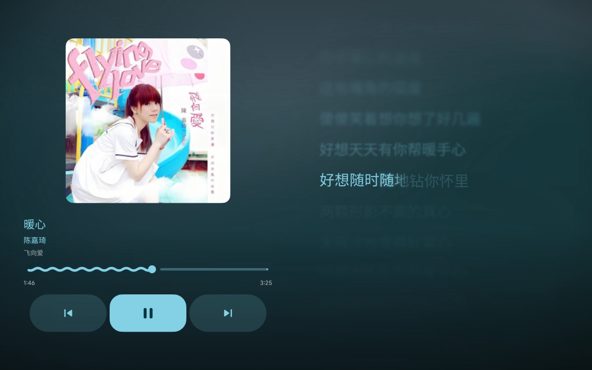
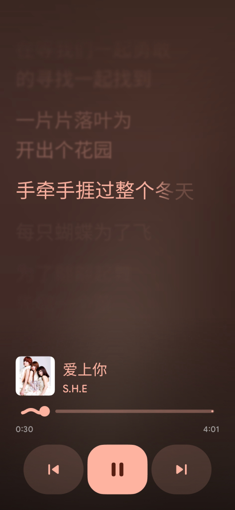

<p align="center">
  
</p>

<h3 align="center">撷句成章，拾韵成行</h3>

<p align="center">
  为任意 Android 媒体会话实时呈现逐字歌词
</p>

<p align="center">
  <a href="https://developer.android.com/about/versions/11"><picture><source media="(max-width: 767px)" srcset="https://img.shields.io/badge/Android-11%2B-6750A4?style=flat-square&logo=android&logoColor=white&labelColor=1D1B20" /></picture></a>
  <a href="https://kotlinlang.org/docs/multiplatform.html"><picture><source media="(max-width: 767px)" srcset="https://img.shields.io/badge/Kotlin-Multiplatform-625B71?style=flat-square&logo=kotlin&logoColor=white&labelColor=1D1B20" /></picture></a>
  <a href="https://m3.material.io/"><picture><source media="(max-width: 767px)" srcset="https://img.shields.io/badge/Material_3-Expressive-7D5260?style=flat-square&logo=materialdesign&logoColor=white&labelColor=1D1B20" /></picture></a>
  <br />
  <a href="https://developer.android.com/jetpack/compose"><picture><source media="(max-width: 767px)" srcset="https://img.shields.io/badge/Jetpack-Compose-6750A4?style=flat-square&logo=jetpackcompose&logoColor=white&labelColor=1D1B20" /></picture></a>
  <a href="LICENSE"><picture><source media="(max-width: 767px)" srcset="https://img.shields.io/badge/license-GPL--3.0-625B71?style=flat-square&labelColor=1D1B20" /></picture></a>
</p>

<div align="center">

**`io.github.jayfunc.carpelines`** · Android 11+ (API 30) · target SDK 37 · GPL-3.0-or-later

[English](README.md) · **简体中文**

</div>

---

## 目录

- [功能亮点](#-功能亮点)
- [应用截图](#-应用截图)
- [下载与安装](#-下载与安装)
- [歌词引擎](#-歌词引擎)
- [文档](#-文档)
- [社区](#-社区)
- [贡献与构建](#-贡献与构建)
- [技术栈](#-技术栈)
- [许可与致谢](#-许可与致谢)

---

##  功能亮点

### 歌词跟着歌声走

- **逐词扫光** — 时间轴直接来自歌词文件本身，每个词在被唱到的瞬间点亮，而不是整行一起跳动。
- **逐字强调，支持中日韩** — 中文、日文、韩文歌词可以逐字扫光，与拉丁文字的弹簧动画完全一致。
- **对唱与和声** — 双列声部布局、背景和声行与按行样式，让重叠部分依然清晰可读。
- **翻译与音译** — 翻译行与音译行堆叠在原文下方，不破坏原有时间轴。

### 富有表现力的歌词页

- **封面取色** — 全幅歌词页会采样当前封面并据此生成配色。
- **流体与专辑模糊背景** — 两种氛围背景，其中流体背景移植自 BetterLyrics 的 `FluidBackgroundEffect` 着色器，并配有动画模糊和长音拖尾辉光。
- **滚动歌词列表** — 当前行始终居中，其余歌词在它身旁流动。
- **自动隐藏的播放胶囊** — 上一首 / 播放暂停 / 下一首与进度浮在歌词之上，几秒后淡出，点按可唤回，暂停时保持常驻；顶部的色调按钮用于返回。
- **单曲偏移与歌词卡片** — 为对不齐的文件微调时间轴，并把当前歌词导出为可分享的卡片。

### 任意播放器，同一块屏幕

- **全系统媒体会话** — 通过 `NotificationListenerService` 与 `MediaSessionManager` 跟踪当前应用、封面、进度与播放状态，并在回调之间做时间外推。
- **三种歌词优先组件** — 正在播放条、带当前歌词行的控制卡片，以及方形磁贴。它们都跟随当前系统会话，可驱动播放控制并打开歌词页。
- **远程遥控，不做本地播放** — CarpeLines 刻意不内置音频引擎或媒体库浏览，它的按钮只驱动已经运行中的播放器。
- **七种歌词来源** — 内嵌标签、同目录 `.lrc` 文件、QQ 音乐（QRC）、网易云音乐（EAPI）、酷狗（KRC）、LRCLIB 与 Apple Music（TTML）。
- **可调整的来源顺序** — 内外部播放共用同一份列表，位于「设置 → 歌词 → 歌词来源顺序」。

<details>
<summary><b>它都处理些什么</b></summary>
<br>

- **格式** — LRC、QRC、KRC 与 TTML，自动识别并归一到同一份带时间轴的歌词文档。
- **来源** — 内嵌标签、同目录 `.lrc`、QQ 音乐、网易云音乐、酷狗、LRCLIB 与 Apple Music。
- **匹配** — 歌名 / 歌手 / 专辑归一化、打分，并把翻译或音译版本合并到基础歌词上。
- **渲染** — 逐词扫光、逐字扫光、对唱分栏、背景和声、翻译、音译、动画模糊、长音辉光，以及在当前行处分割的边缘渐隐。
- **背景** — 流体（移植自 BetterLyrics 的 `FluidBackgroundEffect` 着色器）与专辑模糊两种氛围模式。
- **界面** — 只读的首页当前会话预览、歌词页、收听统计，以及紧凑的设置树。
- **深链接** — `carpelines://lyrics` 与 `carpelines://external_lyrics`；同时保留 `betterlyrics://…` 以兼容旧链接。
- **自定义** — 主题、歌词排版、布局、模糊、来源顺序与单曲偏移。

</details>

---

##  应用截图

<p align="center">
  <a href="docs/assets/screenshots/lyrics-page-landscape.jpg"></a>&nbsp;&nbsp;<a href="docs/assets/screenshots/lyrics-page-portrait.jpg"></a>
</p>

<p align="center"><sub>封面取色与流体背景，播放胶囊浮在歌词之上。</sub></p>

---

##  下载与安装

CarpeLines 需要 **Android 11 (API 30) 或更高版本**。它本身不播放音频：请先授予**通知使用权**，以便读取当前媒体会话，然后在任意播放器中开始播放并打开歌词页。

<div align="center">

| 最新版本（推荐） | 从源码构建 |
| :---: | :---: |
| <a href="https://github.com/jayfunc/CarpeLines/releases/latest"></a><br>由 CI 构建并签名的通用 APK。<br>`stable` 会作为最新版本发布；`alpha` 与 `beta` 为预发布版，见 [Releases 页面](https://github.com/jayfunc/CarpeLines/releases)。 | [Android Studio](#从源码构建) — 以 `src/CarpeLines.KMP` 作为 Gradle 根目录打开，运行 `app` 配置。<br>[Gradle 命令行](#从源码构建) — 使用下面的命令构建通用 debug APK。<br>Debug 版安装为 `io.github.jayfunc.carpelines.debug`。 |

**[所有版本](https://github.com/jayfunc/CarpeLines/releases) | [发布流程](docs/RELEASE.md)**

</div>

### 从源码构建

Gradle 工程位于 `src/CarpeLines.KMP`，所有任务都需在该目录下执行。需要 JDK 21 与 Android SDK 37。

```sh
cd src/CarpeLines.KMP
JAVA_HOME=/usr/lib/jvm/java-21-openjdk ./gradlew :app:assembleDebug -Pcarpelines.enableAbiSplits=false
```

`-Pcarpelines.enableAbiSplits=false` 会产出单个通用 APK；ABI 拆分默认开启。APK 输出到 `app/build/outputs/apk/debug/`。Windows 下：

```powershell
cd src\CarpeLines.KMP
.\gradlew.bat :app:assembleDebug "-Pcarpelines.enableAbiSplits=false"
```

---

##  歌词引擎

歌词域位于 Kotlin Multiplatform `shared` 模块中，使解析、匹配与合并保持独立于 Android UI 代码。

| 层 | 职责 |
| :--- | :--- |
| **解析** | LRC、QRC、KRC 与 TTML 解析器，格式检测与归一为统一的时间轴文档 |
| **解密** | QRC / KRC 载荷解密与网易 EAPI 请求签名 |
| **来源** | QQ 音乐、网易云音乐、酷狗、LRCLIB 与 Apple Music 客户端 |
| **匹配** | 元数据归一化、候选打分与最佳匹配选择 |
| **流水线** | 归一化、合并、翻译与音译 |

Android 端在 `data/carpelines/` 下把共享引擎接入标签读取、媒体会话状态与 Compose UI。来源顺序由用户掌管：无论歌词来自应用内页面还是外部播放器，都使用同一份可排序列表。

---

##  文档

- [歌词引擎参考](docs/LYRICS_ENGINE_REFERENCE.md) — 与 BetterLyrics 源码的逐组件对照
- [M3 Expressive 设计系统](docs/M3E-DESIGN-SYSTEM.md) — 设计令牌、组件与动效
- [品牌标识规范](logo/index.html) — 标记的几何、配色与使用规则
- [发布清单](docs/RELEASE.md) — 版本、签名与本地检查
- [依赖许可](docs/DEPENDENCY_LICENSES.md) — 完整依赖审计
- [贡献指南](CONTRIBUTING.md) — 目录结构、构建命令与评审要求
- [安全策略](SECURITY.md) — 如何私下报告漏洞

---

##  社区

加入 QQ 群获取支持、反馈问题并跟进更新：

<div align="center">

**[QQ 群 1](https://qm.qq.com/q/iQXiGO58I2)（1053136454）| [Telegram](https://t.me/carpelines)**

</div>

---

##  贡献与构建

常用本地检查，在 `src/CarpeLines.KMP` 下执行：

```sh
JAVA_HOME=/usr/lib/jvm/java-21-openjdk ./gradlew :app:compileDebugKotlin
JAVA_HOME=/usr/lib/jvm/java-21-openjdk ./gradlew :shared:jvmTest
JAVA_HOME=/usr/lib/jvm/java-21-openjdk ./gradlew :app:testDebugUnitTest
```

提交 pull request 前请先阅读 [CONTRIBUTING.md](CONTRIBUTING.md)。欢迎贡献：保持改动聚焦，并尽量附上测试 / 构建结果。

<details>
<summary><b>项目结构</b></summary>
<br>

```text
.                                         仓库根目录（README、LICENSE、docs、品牌资源）
- src/CarpeLines.KMP/                     Gradle 根目录（rootProject.name = "CarpeLines"）
  - app/src/main/java/io/github/jayfunc/carpelines/
    - data/                               Room、仓库、偏好设置、服务与 Worker
    - data/carpelines/                    共享歌词引擎桥接、来源顺序、映射器
    - data/external/                      系统媒体会话监听与远程遥控
    - di/                                 Hilt 模块
    - presentation/                       Compose 页面、组件、导航与 ViewModel
    - ui/                                 M3 Expressive 组件、主题、Glance 小组件
    - utils/                              通用工具
  - app/schemas/                          导出的 Room schema
  - shared/src/commonMain/kotlin/io/github/jayfunc/carpelines/lyrics/
    - model/                              歌词文档、来源提供方、解析选项
    - parse/                              LRC、QRC、TTML 解析器与格式检测
    - provider/                           LRCLIB、Apple Music、QQ 音乐、网易云、酷狗
    - decrypt/                            QRC / KRC 载荷解密
    - match/                              元数据匹配与打分
    - pipeline/                           归一化、合并与翻译
  - baselineprofile/                      Macrobenchmark 与 baseline profile 生成
  - gradle/                               版本目录与 Gradle Wrapper
- docs/                                   引擎参考、设计系统、发布与依赖说明
- logo/                                   品牌资源、标识规范页与生成脚本
- .github/                                CI 与 issue 模板
```

</details>

---

##  技术栈

| 领域 | 技术 |
| :--- | :--- |
| 语言 | Kotlin、Kotlin Multiplatform |
| UI | Jetpack Compose、Material 3 Expressive |
| 播放 | 外部系统媒体会话（`NotificationListenerService`、`MediaSessionManager`） |
| 媒体访问 | `NotificationListenerService`、`MediaSessionManager`、`MediaController` |
| 数据库 | Room |
| 依赖注入 | Hilt |
| 偏好设置 | DataStore、EncryptedSharedPreferences |
| 后台任务 | WorkManager |
| 网络 | Retrofit、OkHttp、Ktor |
| 图片 | Coil |
| 元数据 | TagLib |

---

##  许可与致谢

CarpeLines 基于 **[GNU General Public License v3.0](LICENSE)** 发布（`SPDX-License-Identifier: GPL-3.0-or-later`）。

<details>
<summary><b>完整 GPL 声明</b></summary>
<br>

```text
CarpeLines
Copyright (C) 2026 The CarpeLines Contributors
Derived from PixelPlayerOSS, Copyright (C) 2026 Theo Vilardo
Includes components adapted from BetterLyrics, Copyright (C) jayfunc and BetterLyrics contributors
Includes components adapted from Zenith, Copyright (C) 1372Slash and Zenith contributors

This program is free software: you can redistribute it and/or modify
it under the terms of the GNU General Public License as published by
the Free Software Foundation, either version 3 of the License, or
(at your option) any later version.

This program is distributed in the hope that it will be useful,
but WITHOUT ANY WARRANTY; without even the implied warranty of
MERCHANTABILITY or FITNESS FOR A PARTICULAR PURPOSE.  See the
GNU General Public License for more details.

You should have received a copy of the GNU General Public License
along with this program.  If not, see <https://www.gnu.org/licenses/>.
```

</details>

### 维护者

| 维护者 | 角色 |
| :--- | :--- |
| **[jayfunc](https://github.com/jayfunc)** | 核心开发 / 项目负责人（`C` `I` `Q` `D`） |

> `C` 代码 ╹ `I` 国际化 ╹ `Q` 质量保障 ╹ `D` 文档

### 组件致谢

| 项目 | CarpeLines 借用了什么 |
| :--- | :--- |
| [BetterLyrics](https://github.com/jayfunc/BetterLyrics) | 卡拉 OK 时间轴与逐字扫光模型、歌词卡片模板、流体 / 雨滴 / 飘雪氛围着色器、WinUI 视觉默认值 |
| [PixelPlayerOSS](https://github.com/PixelPlayerHQ/PixelPlayerOSS) | 应用外壳：媒体会话监听、远程遥控、设置树、首页预览 |
| [Lyricify-Lyrics-Helper](https://github.com/WXRIW/Lyricify-Lyrics-Helper) | QRC / KRC 解密与网易 EAPI 请求签名，已移植到 Kotlin |
| [Accompanist Lyrics](https://github.com/6xingyv/accompanist-lyrics-core) | 卡拉 OK 行与词视图（`lyrics-core`、`lyrics-ui`） |
| [Zenith](https://github.com/1372Slash/Zenith) | 底部导航栏（`ShortNavigationBarItem` 胶囊）与活动热力图墙 |
| [LRCLIB](https://lrclib.net/) | 社区歌词 API，供 LRCLIB 来源使用 |

### 依赖

| 包 | 说明 |
| :--- | :--- |
| [Room](https://developer.android.com/jetpack/androidx/releases/room) | 存储历史、统计与歌词缓存的本地数据库 |
| [Hilt](https://dagger.dev/hilt/) | 依赖注入 |
| [WorkManager](https://developer.android.com/jetpack/androidx/releases/work) | 延迟后台任务 |
| [DataStore](https://developer.android.com/jetpack/androidx/releases/datastore) | 偏好设置存储 |
| [Retrofit](https://square.github.io/retrofit/) / [OkHttp](https://square.github.io/okhttp/) / [Ktor](https://ktor.io/) | 歌词来源网络请求 |
| [Coil](https://coil-kt.github.io/coil/) | 封面与图片加载 |
| [Accompanist Lyrics](https://github.com/6xingyv/accompanist-lyrics-core) | 卡拉 OK 行与词渲染 |
| [TagLib](https://taglib.org/) | 音频内嵌标签与歌词读取 |
| [Media3 FFmpeg 解码器](https://github.com/jellyfin/jellyfin-media3-ffmpeg-decoder) | 可选扩展音频解码（GPL-3.0） |

分发的 APK 包含按各自许可发布的第三方组件，完整清单见
[THIRD_PARTY_NOTICES.md](src/CarpeLines.KMP/app/src/main/assets/licenses/THIRD_PARTY_NOTICES.md)，
其中包括 Lyricify-Lyrics-Helper（Apache-2.0），以及从前身 PixelPlayer 仓库继承的 MIT 授权部分
（MIT 至 2026-05-12，即上游切换为专有许可之前）。CarpeLines 本身仍为 GPL-3.0-or-later。

---

<div align="center">

  <sub>© 2026 CarpeLines 贡献者。保留所有权利。</sub><br>
  <sub>本项目按「原样」提供。所有第三方资源归其各自所有者所有。</sub>

</div>
